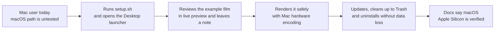

# Master Plan — macOS verified support

- Plan ID: `macos-verified-support`
- Master version: 31
- Status: active
- Created: 2026-11-14
- Source: user request (2026-11-14): "I need to create a macOS compatible version of this project. create a plan to achieve this"
- Size: large
- Owner: coordinator agent (Claude Code); approvals by Jorge Venegas
- Plan directory: `docs/plans/macos-verified-support`
- Branch: `plan/macos-verified-support`

`Status` is one of `draft`, `active`, `complete`, or `blocked`. `approve` sets `active`; `close` sets `complete` when every phase is done.

### Intake

- Problem: VideoHub already contains a macOS code path (`server/platform.js` darwin branch, Bash lifecycle scripts, `.command` launcher, LaunchAgent, VideoToolbox encoders), but `docs/PLATFORMS.md` states it was only exercised by injected tests on Windows and has never run on a real Mac. Read-only probes on this Mac already show Mac-specific defects.
- Outcome: a Mac user can install, review, render, protect, update and uninstall VideoHub on Apple Silicon macOS with the same contracts as Windows, and the docs state that this was verified on real hardware.
- Acceptance: D1–D8 below.
- Constraints: one shared codebase (no fork); CLAUDE.md rules hold — no native modules, compiled helpers or `.app` bundle; Windows behavior and public return shapes unchanged except the package-manager switch (C4); pnpm for every install/test command; no hard-delete fallback; renders only after preview review and explicit request; tests isolate home/temp/data under `.test-tmp`.
- Non-goals: see section 5.
- Unknowns: answered below (U1–U4).
- Size: large — several subsystems (platform layer, installer, render queue/guard, agent integrations, docs) and real-machine acceptance across sessions.

Gap answers (2026-11-14, Jorge Venegas):

- U1 Goal: **verify and fix the existing macOS support** in the shared codebase; not a separate build, not an `.app` bundle.
- U2 Real-account checks: **scratch install on the real account** — install a copy into a scratch folder with a scratch workspace, walk through permission prompts with the user, then uninstall. Never touch the user's films, real workspace or agent configuration without asking first.
- U3 Baseline failures: **fix in the first phase** so `npm test` is green before macOS work.
- U4 Hardware: **Apple Silicon only**; Intel macOS stays "implemented, not verified".
- U5 Package manager (refinement round 1): **pnpm for development and the product** — installer, update, lockfile, docs and film templates move from npm to pnpm on every OS (C4, C5, L1).

## 1. Objective

A VideoHub user on an Apple Silicon Mac can install VideoHub with `setup.sh`, open the hub from the Desktop launcher, review a code-made film in live preview and leave notes, render it with VideoToolbox through the protected queue, stop a render, send files to the Finder Trash, start the hub at login, update without losing data, uninstall cleanly, and use the `hub_*` tools from Claude Code — and `docs/PLATFORMS.md` reports macOS (Apple Silicon) as verified on real hardware instead of "pending".

## 2. Goal flow

## 3. Definition of done

- [ ] D1 — The full test suite passes on this Mac with zero failures — verify: `pnpm test` → `fail 0`
- [ ] D2 — Platform calls return Mac-correct data on real hardware: the GPU is named in the encoder result, and the Desktop launcher and LaunchAgent use a stable Node path that survives a Homebrew Node upgrade (version-manager installs keep the versioned path; re-running setup refreshes it) — verify: darwin unit tests in `server/platform.darwin.test.js` plus a read-only probe script run on this Mac
- [ ] D3 — A scratch install made with `bash setup.sh` on the real account opens the hub from `VideoHub.command` (Gatekeeper first-launch documented), shows the example film in live preview, saves a note, and the folder picker and Finder reveal work — verify: user observation recorded in P3 closeout + `node server/cli.js hub_workspace` on the scratch port
- [ ] D4 — One reviewed render of a scratch example completes through the queue with sound and VideoToolbox, background QoS/niceness and RAM protection apply, CPU sliders are hidden with the explanation, and Stop's whole-tree termination (including Chrome relaunched during Stop) is fixed and proven with real processes — verify: `ffprobe` on the output, `ps -o pid,ppid,nice,pri,command` during render, UI observation, `node --test server/killtree-unix.test.js`
- [ ] D5 — Finder Trash cleanup is restorable (Automation prompt handled, no hard delete), the LaunchAgent starts the hub at login, update preserves data/notes, and uninstall removes only owned integrations — verify: restore from Finder, `launchctl print gui/$(id -u)/com.videohub.hub`, data diff before/after update, uninstall dry-run then run
- [ ] D6 — A new Claude Code session exposes the `hub_*` tools from the scratch install (OpenCode checked if the user agrees) — verify: tool list in a fresh agent session
- [ ] D7 — `docs/PLATFORMS.md`, `README.md` and `CLAUDE.md` state macOS Apple Silicon as verified on real hardware, Intel as pending, list pnpm as a requirement, and record any new macOS limits found — verify: `grep -n "macOS\|pnpm" docs/PLATFORMS.md README.md CLAUDE.md`
- [ ] D8 — VideoHub uses pnpm end to end: `pnpm-lock.yaml` replaces `package-lock.json` and `package.json` pins `packageManager`; setup/update install dependencies with `pnpm install --frozen-lockfile` on every OS and print install hints when pnpm is missing; an npm-era install updates to pnpm without losing data; docs and film templates say pnpm; no `npm ci`/`npm install`/`npm test` instruction remains outside retired-history notes — verify: `pnpm test`, installer dry-run output under `.test-tmp`, `grep -rn "npm ci\|npm install\|npm test\|package-lock" --exclude-dir=node_modules --exclude-dir=.git .`
- [ ] D9 — After the scratch install is updated with the Stop fix, a real scratch render stopped partway leaves no render, Chrome or ffmpeg process behind — verify: `ps -p` on the recorded tree and an orphan search 5 s after `POST /api/jobs/JOB-ID/cancel`

## 4. Code standards

| Topic | Rule or command |
|---|---|
| Source of truth | `CLAUDE.md` (Development rules), `docs/ARCHITECTURE.md`, `docs/PLATFORMS.md` |
| Format | none (no formatter configured; match the compact ES module style of surrounding code) |
| Lint | none |
| Type check | `node --check` on every changed .js/.mjs file |
| Tests | `pnpm test` (runs `node scripts/test.mjs`; isolates home/temp/data under `.test-tmp`); baseline after P7: 345 tests, 344 pass, 0 fail, 1 skipped |
| Dependencies | `pnpm install --frozen-lockfile`; never `npm install`/`npm ci`. Since P7 the lockfile exists, so plain `pnpm test` is the test command (L2 workaround retired) |
| Project rules | OS selection stays in `server/platform.js` with injectable deps; preserve Windows behavior and exported names/return shapes; read old stored values through `legacy.js`; UI never imports `server/`; test hubs use `VIDEOHUB_PORT=7799`, `VIDEOHUB_DATA_DIR`/`VIDEOHUB_BASE_DIR` scratch, `VIDEOHUB_GUARD=off`, `VIDEOHUB_JOBS=off`, `VIDEOHUB_NO_WINDOW=1` (guard/jobs on only in P4); keep `templates/new-film/render.js` equal to `examples/hello-film/render.js`; inspect staged diff for private paths, identities and tokens before commit |

## 5. Non-goals

- A separate macOS fork, distribution or branch-specific build.
- A signed or unsigned `.app` bundle, notarization, native modules or compiled helpers (CLAUDE.md forbids them).
- Intel macOS verification (no hardware); Linux verification.
- CPU-core affinity on macOS (no supported API; already documented as unavailable).
- Changes to Windows behavior other than the pnpm switch (C4), refactors of shared code not required by a macOS defect, and new features.
- Touching the user's real workspace, films or existing agent configuration without asking first.

## 6. Current state and assumptions

| Area | Evidence | Constraint or surprise |
|---|---|---|
| Request | User request 2026-11-14; answers U1–U4 above | Verify-and-fix in the shared codebase |
| Machine | `uname -m` → arm64; macOS 26.6.2 (25G83); Node 24.16.0 via asdf; `/opt/homebrew/bin/ffmpeg`; Google Chrome in `/Applications`; `claude` and `opencode` CLIs in `/opt/homebrew/bin` | No Intel Mac, no Edge/Chromium |
| macOS code path | `server/platform.js:319-550` (Unix `createPlatform` branch, `IS_MAC`); `scripts/install.mjs:153,241,247` (`VideoHub.command`); `server/platform.js:502-506` (LaunchAgent `com.videohub.hub.plist`) | Implemented, never run on a Mac |
| Existing tests | `server/platform.darwin.test.js` (13 tests), macOS cases in `scripts/install.test.js:65-80` | Injected-dependency tests only |
| Baseline | `npm test` (before C4) → 342 tests, 338 pass, **3 fail**, 1 skipped | Failures: `scripts/upload-rules.test.js:19` and `scripts/distribution-safety.test.js:10` flag the committed `.agents/`/`.claude/` skill folders (dot names, symlinks); `scripts/windows-safety.test.js:28` requires `open.ps1` to be absent but it is tracked |
| Encoder probe | `node scripts/init-config.mjs --detect` → `{"available":["videotoolbox","x264"],"best":"videotoolbox","gpus":[]}` | VideoToolbox works; GPU list empty |
| Volumes | `volumes()` probe → 19 mounts including `/dev`, `/System/Volumes/{VM,Preboot,Update,xarts,iSCPreboot,Hardware,Data}` and CoreSimulator images | Noise in storage UI and mount matching |
| GPU names | `server/platform.js:534` `gpuNames()` returns `[]` when `IS_MAC` | No GPU shown on Mac |
| Launcher Node path | `scripts/install.mjs:241` writes `process.execPath` into `VideoHub.command`; LaunchAgent uses the same | asdf → `~/.asdf/installs/nodejs/24.16.0/bin/node`; Homebrew → versioned Cellar path; both break after a Node upgrade |
| asdf under fake HOME | `bash setup.sh --dry-run` under a `.test-tmp` HOME exited 126 because `/Users/jorge/.asdf/shims/node` depends on the real HOME | Probes and tests on this Mac must put a real `node` first on PATH |
| Windows-only exports | `server/platform.js:317` exports `getShortcut`/`setShortcut`/`getAutostartState`, absent from the Unix return at `:550` | All callers in `scripts/install.mjs` are guarded by `platform.IS_WIN`; harmless, recorded as a note |

**Assumptions:** Finder Automation, Gatekeeper and LaunchAgent behavior on macOS 26 match the documented flows (checked in P3/P5 with the user). Puppeteer renders use the installed Chrome via existing browser lookup (checked in P4).
**Unknowns:** Which further defects real-hardware runs reveal in P3–P5; those become discoveries and, if large, new phases.

## 7. Phase map

| ID | Phase | Outcome | Depends on | Status | Plan |
|---|---|---|---|---|---|
| P1 | Green baseline | pnpm test passes with zero failures on this Mac | none | done | [plan](phases/01-green-baseline/plan.md) |
| P7 | pnpm migration | Installer, update, lockfile, docs and film templates use pnpm on every OS; npm-era installs migrate on update | P1 | done | [plan](phases/07-pnpm-migration/plan.md) |
| P2 | macOS platform fixes | GPU name and stable launcher Node path are correct on real macOS, with darwin tests | P7 | done | [plan](phases/02-macos-platform-fixes/plan.md) |
| P3 | Scratch install and review | Scratch setup.sh install opens from VideoHub.command; live preview, notes, folder picker and Finder reveal work | P2 | done | [plan](phases/03-scratch-install-and-review/plan.md) |
| P4 | Render and protection | One reviewed VideoToolbox render with sound; Stop, QoS/niceness, RAM protection and hidden CPU sliders verified | P3 | done | [plan](phases/04-render-and-protection/plan.md) |
| P5 | Lifecycle and agents | Data-preserving update, real stopped render without orphans, LaunchAgent, Finder Trash restore, Claude Code hub_* tools, clean uninstall | P4 | in_progress | [plan](phases/05-lifecycle-and-agents/plan.md) |
| P6 | Docs verified status | PLATFORMS/README/CLAUDE docs mark macOS Apple Silicon verified and record new limits | P5 | planned | pending |

Exit criteria per phase: P1 → D1; P7 → D8 and D1 still green; P2 → D2 and D1 still green; P3 → D3; P4 → D4; P5 → D5, D6, D9; P6 → D7 and a final `pnpm test`. Each of P3–P5 fixes the macOS defects it finds inside its own scope; a defect that needs more than a targeted fix becomes a new phase.

Status: `planned`, `ready`, `in_progress`, `done`, `blocked`, `needs_replan`, `superseded`.
`ready` means the user has explicitly approved that phase plan. A written plan is not `ready` until it passes the approval gate. Later phases may stay as outlines; add them with `add-phase --outline`, then write the plan with `write-plan` just before the phase starts and stop for approval.

A phase plan with `Parallel safe: yes` may be approved before its dependencies are done. Use it only for phases the master explicitly marks independent. No phase in this plan is parallel safe: P3–P5 share one scratch install, P2–P5 share `server/platform.js`, and P7 and P2 share `scripts/install.mjs`. Execution order: P1 → P7 → P2 → P3 → P4 → P5 → P6.

## 8. Cross-phase decisions

Append-only. Supersede a decision with a new row; never delete history.

| ID | Date | Decision | Reason | Affects |
|---|---|---|---|---|
| C1 | 2026-11-14 | Fix macOS in the shared codebase behind `IS_MAC`; no fork and no `.app` bundle | U1; CLAUDE.md forbids unsigned bundles and compiled helpers | all |
| C2 | 2026-11-14 | Real-account checks use one scratch install (`~/VideoHubScratch/install`) and scratch workspace (`~/VideoHubScratch/workspace`) on port 7799, created in P3 and removed at the end of P5; agent registration on the real profile only after asking the user | U2; CLAUDE.md forbids touching the user's films or another install | P3, P4, P5 |
| C3 | 2026-11-14 | Probes and tests on this Mac put a real Node binary first on PATH (asdf shims depend on the real HOME) | Baseline: `setup.sh` exited 126 under a fake HOME | all |
| C4 | 2026-11-14 | Use pnpm everywhere: plan/dev commands (pnpm test, pnpm install) and the product (installer, update, lockfile, docs, film templates) on every OS | User requirement 2026-11-14 ('we must use pnpm'), scope confirmed as dev + product migration | all |
| C5 | 2026-11-14 | Setup and update check for pnpm and print OS install hints when missing (brew install pnpm / winget install -e --id pnpm.pnpm / npm install -g pnpm); they never install it; package.json pins the version with packageManager | CLAUDE.md: setup only prints instructions for system tools; a pinned version keeps the lockfile format stable | P7,P3,P5,P6 |
| C6 | 2026-11-14 | Standing review instruction: the user approved P1 and asked to continue until the entire plan is complete without per-phase review stops; each later phase plan is still written just in time, checked, committed, and approved under this recorded instruction. Stops remain where CLAUDE.md or C2 require the user: live-preview review before any render, OS permission prompts, and registration on the real agent profile | User instruction 2026-11-14: 'approve P1 and continue until the entire plan has been completed' | all |
| C7 | 2026-11-14 | Implementation subagents run on the Sonnet 5.5 model (Agent tool model: sonnet) | User instruction 2026-11-14 | all |
| C8 | 2026-11-15 | Scratch install on the real account (answered 2026-11-15): setup registers Claude Code only (MCP + skill), no global rule block in ~/.claude/CLAUDE.md, no OpenCode; it creates the Desktop VideoHub.command and P5 enables the login LaunchAgent; P5 uninstall removes all of them. The scratch install's own data/config.json pins port 7799. No other VideoHub install exists on the account (checked: no ~/Documents/VideoHub, Desktop command, LaunchAgent, or listener on 7788/7799) | User answers to the R3/launcher questions; CLAUDE.md requires asking before touching the real agent profile | P3,P4,P5,P6 |
| C9 | 2026-11-15 | P4 renders the scratch hello-film twice, one at a time: one full render to completion (user approval 2026-11-15 after preview review) and one started and stopped after about 10 s to verify whole-tree Stop | User answers 2026-11-15 | P4 |
| C10 | 2026-11-15 | One extra scratch render of hello-film with hub_render env {DUR:"120"} (no film code change) to snapshot priority/background QoS and press Stop partway; stopped before completion | User approval 2026-11-15 after the 5 s render made A2/A4 unobservable | P4 |
| C11 | 2026-11-15 | After the Stop fix, P5 updates the scratch install and runs one more 120 s scratch render that is stopped partway, to confirm no orphans on real hardware | User answer 2026-11-15 | P4,P5 |

## 9. Discovery ledger

Append-only. One row per discovery that changed or could change a plan. Use `note` for findings worth keeping with no plan change.

| ID | Date | Phase | Affects | Discovery | Type | Action taken | Status |
|---|---|---|---|---|---|---|---|
| L1 | 2026-11-14 | P1 | all | User requires pnpm instead of npm for development and the shipped installer; installer (scripts/install.mjs:164-165 npm ci, :280-289 package-lock.json), README, CLAUDE.md, ARCHITECTURE.md and film templates reference npm | scope-change | Confirmed with user (dev + product). Added D8 and phase P7 pnpm migration before P2; plan/dev commands switched to pnpm | applied |
| L2 | 2026-11-14 | P1 | P1,P7 | pnpm 11 auto-installs before 'pnpm test' when node_modules is missing or stale, creating node_modules/ and pnpm-lock.yaml from package.json (seen 2026-11-14 during refinement; artifacts removed). '--config.verify-deps-before-run=false' runs the script without installing | phase-amend | P1 runs 'pnpm --config.verify-deps-before-run=false test' and must leave no pnpm-lock.yaml/node_modules; P7 owns creating the lockfile and decides the steady-state test command | applied |
| L3 | 2026-11-14 | P1 | P7 | R6 checked in scratchpad: after npm ci, 'pnpm import' converted package-lock.json to pnpm-lock.yaml and 'pnpm install --frozen-lockfile </dev/null' replaced the npm node_modules non-interactively (exit 0, pnpm 11.5.2) | next-phase-amend | P7 generates pnpm-lock.yaml with 'pnpm import' to keep resolved versions; keep an npm→pnpm update test but no purge flag is needed | applied |
| L4 | 2026-11-14 | P2 | P2 | volumes() has no consumer on macOS: its only caller is the Linux freedesktop Trash fallback in trashOne (server/platform.js:413); macOS trashes through Finder. The 19-mount output is not user-visible. gpuNames() is user-visible via ui/app.js:186 encoder note; system_profiler SPDisplaysDataType -json reports _name 'Apple M2 Max'. Launcher rule: use a PATH node only when its realpath equals process.execPath (Homebrew /opt/homebrew/bin/node qualifies; asdf shims do not) | master-amend | D2 drops volume filtering; P2 covers GPU name and stable launcher Node path only | applied |
| L5 | 2026-11-14 | P7 | P6 | Windows platform.findTool does not try .cmd, so install.mjs looks up pnpm.cmd itself; Windows pnpm install is covered only by injected tests (R5) | note | P6 docs mark Windows pnpm install as verified by tests only, real Windows pending | open |
| L6 | 2026-11-15 | P3 | P3 | hub_workspace tells agents 'New films go in: FILMS\FILM-NAME ... copy templates\new-film' with hard-coded Windows separators (server/tools.js:87), misleading agents on macOS/Linux | phase-amend | Added P3 step S5: use the platform separator, with a test | applied |
| L7 | 2026-11-15 | P3 | P3,P6 | Setup ignores --workspace when data/config.json already exists without a workspace (seeded {port:7799} made dry-run keep ~/Documents/VideoHub); setup writes port 7788 even when VIDEOHUB_PORT is set, so a custom port must be set in config.json after setup. Plan S1 order was wrong; worker set the port after setup | plan-defect | Missed fact: initConfig treats any config.json as installed. P3 evidence records the post-setup port edit; P6 notes it if docs describe custom ports. Not a macOS defect; no code change | applied |
| L8 | 2026-11-15 | P3 | P4,P5 | Scratch launcher Node is asdf 22.22.3 (asdf global for that folder), not 24.16.0; versioned path as designed. /api/capabilities and /api/settings do not exist; real endpoints are /api/config and /api/encoders. hub_* CLI takes a JSON argument | note | P4/P5 use /api/config, /api/encoders and JSON CLI arguments | applied |
| L9 | 2026-11-15 | P3 | P6 | Gatekeeper showed no prompt when the user double-clicked the setup-generated VideoHub.command: xattr has no com.apple.quarantine (local file). Docs (PLATFORMS.md, CLAUDE.md, install.mjs setup message) say macOS may block its first launch | next-phase-amend | P6 corrects the Gatekeeper wording; setup message change is P6's call | open |
| L10 | 2026-11-15 | P4 | P4 | The 10 s example renders in about 5 s, too fast to snapshot priority/QoS or press Stop after ~10 s; the second permitted render ran to completion (hello-film_v2.mp4) because the worker's zsh capture script failed. Renders-page Stop for a queued job uses POST /api/jobs/JOB-ID/cancel; slow/normal commands act only on a tracked running render | plan-defect | Missed fact: render duration. User approved one extra scratch render with env DUR=120 (C10); added S5 for A2/A4 via /api/jobs/:id/cancel | applied |
| L11 | 2026-11-15 | P4 | P4,P5,P6 | Stop leaves orphan headless Chrome on Unix: killTree SIGTERMs the tree, puppeteer's SIGTERM handler keeps node render.js alive, its chunk-retry restart() relaunches Chrome, puppeteer starts Chrome in its own process group, so the later group SIGKILL misses it and it is reparented to pid 1 (2 browsers, 14 pids observed; coordinator killed them after confirming puppeteer profiles) | phase-amend | Added P4 S6: Unix killTree freezes the root (SIGSTOP) before terminating, re-reads the tree, TERM then KILL children, KILL root; real-process test reproduces the relaunch. Real stopped-render confirmation in P5 after update (C11). P6 documents the fix | applied |
| L12 | 2026-11-15 | P4 | P6 | Slow mode set nice 19 / pri 4 on the render tree except two Chrome 'Aperitif Renderer' helpers (stayed nice 10); after normal, pri returned but nice stayed 19 (unprivileged niceness cannot be lowered, as documented best effort) | note | P6 mentions that some Chrome helper processes may keep normal priority in slow mode | open |
| L13 | 2026-11-15 | P4 | P4,P5 | D4 bundled a real-render Stop check that P4 could only prove with a real-process test after fixing killTree; the real stopped render needs the scratch install updated first (P5) | master-amend | Split D4: D4 keeps render/encoder/QoS/RAM/CPU controls and the proven Stop fix; new D9 (P5) = a stopped real render after update leaves no orphans | applied |
| L14 | 2026-11-15 | P5 | P5,P6 | macOS Trash always fails: trashOne's AppleScript evaluates POSIX file inside tell application Finder, which Finder cannot resolve (error -1728 'Can't get POSIX file'); the user's UI delete of trash-test was refused and the source kept. Reproduced on a scratchpad folder; coercing 'POSIX file (item 1 of argv) as alias' before the tell block works (exit 0, item in Trash). The error message wrongly blames Automation permission | phase-amend | Added P5 S6 (fix + test) and S7 (re-update scratch install, user retries delete and Put Back); P6 documents the fix | applied |
| L15 | 2026-11-15 | P5 | P6 | With login startup enabled, update.sh stops the hub but the LaunchAgent does not restart it (RunAtLoad, no KeepAlive); the hub stays down until the user opens VideoHub or logs in again (worker used launchctl kickstart) | note | P6 docs: after updating on macOS, open VideoHub (or log in again) to restart the hub | open |

Types: `note`, `phase-amend`, `next-phase-amend`, `master-amend`, `new-phase`, `scope-change`, `plan-defect`.
Statuses: `open`, `applied`, `superseded`, `wontfix`. Only `superseded` rows are skipped by discovery propagation.

Every row must have an `Affects` value: `all`, one phase ID, or a comma-separated list/range such as `P3–P5`. `check` fails a `ready`, `in_progress`, or `done` phase that does not list every affecting row in its `Prior discoveries applied` table.

## 10. Open questions, risks, and blockers

| ID | Question or risk | Owner | Needed by | Status |
|---|---|---|---|---|
| R1 | Real-hardware runs (P3–P5) may surface defects too large for a targeted fix | coordinator | P3–P5 closeouts | open — add a new phase if so |
| R2 | Finder Automation / Gatekeeper prompts need the user at the keyboard | Jorge Venegas | P3, P5 | open |
| R3 | Registering MCP/skill with the real Claude Code/OpenCode profile changes user config | Jorge Venegas | P5 | open — ask before registering; uninstall must remove only owned entries |
| R4 | Other sessions may be running a real VideoHub hub on port 7788 | coordinator | P3 | open — scratch uses 7799 only |
| R5 | The pnpm switch changes the Windows installer, but no Windows machine is available; only injected tests cover it | Jorge Venegas | P7 | open — record Windows real-machine pnpm check as pending in docs |
| R6 | Updating an npm-era install: pnpm may refuse to replace an npm `node_modules` without a TTY | coordinator | P7 | open — P7 must cover the npm → pnpm update path in a fake-home test |
| R7 | pnpm's symlinked `node_modules` must still let film `render.js` resolve `puppeteer-core` from `VIDEOHUB_DIR`, and update must not trip its symlink refusals | coordinator | P7, P4 | open — verify in P7 tests and the P4 render |

## 11. Closeout history

| Phase | Date | Verdict | Criteria met | Commit | Report |
|---|---|---|---|---|---|
| P1 | 2026-11-14 | addressed | A1, A2, A3, A4 | 23de366 | [report](phases/01-green-baseline/plan.md) |
| P7 | 2026-11-14 | addressed | A1, A2, A3, A4, A5, A6 | 94b012e | [report](phases/07-pnpm-migration/plan.md) |
| P2 | 2026-11-15 | addressed | A1, A2, A3, A4, A5 | 020e394 | [report](phases/02-macos-platform-fixes/plan.md) |
| P3 | 2026-11-15 | addressed | A1, A2, A3, A4, A5, A6 | 6abc3fb | [report](phases/03-scratch-install-and-review/plan.md) |
| P4 | 2026-11-15 | addressed | A1, A2, A3, A4, A5, A6 | a37040d | [report](phases/04-render-and-protection/plan.md) |

## 12. Resume brief

- Current phase: P1 (draft plan awaiting approval)
- Last verdict: none
- Next action: re-present refined P1 (v2) for approval, then delegate to a worker subagent
- Open decisions: R2, R3
- PR: declined (2026-11-14)
- Last updated: 2026-11-14
