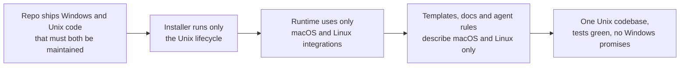

# Master Plan — Remove Windows support

- Plan ID: `remove-windows-support`
- Master version: 10
- Status: active
- Created: 2026-11-17
- Source: user request (2026-11-17): "I want to get rid of all windows related code and support"
- Size: large
- Owner: coordinator agent (Claude Code), user approves phases
- Plan directory: `docs/plans/remove-windows-support`
- Branch: `plan/remove-windows-support`

`Status` is one of `draft`, `active`, `complete`, or `blocked`. `approve` sets `active`; `close` sets `complete` when every phase is done.

Intake:

```text
Source: user request, 2026-11-17
Problem: VideoHub carries a full Windows implementation (platform branch, installer branches, .cmd/.ps1 entry points, Windows-only tests, security tooling and docs) that the project no longer wants to support or maintain.
Outcome: VideoHub is a macOS + Linux project. Its code, tests, installer, templates, docs and agent instructions contain no Windows paths, branches, entry points or promises.
Acceptance: D1–D6 below.
Constraints: keep macOS (verified) and Linux behavior and public MCP/HTTP result shapes; keep legacy.js stored-value reading; tests isolate under .test-tmp; no work against real installs or films.
Non-goals: see section 5.
Unknowns: answered 2026-11-17: keep macOS + Linux; no special handling (no refusal message) on Windows; full cleanup of Windows-only names, aliases and legacy-migration code.
Size: large
```

## 1. Objective

After this plan, VideoHub supports exactly macOS and Linux. A maintainer reading the code finds only Unix code paths: `server/platform.js` has no `win32` branch, the installer has no `IS_WIN` branches or legacy Windows migration, and no `.cmd`/`.ps1` entry points, Windows security tooling or Windows-only tests ship. A user or agent reading README, CLAUDE.md, AGENTS.md, docs and the skill sees macOS + Linux install, update and uninstall instructions only. macOS and Linux behavior, tests and public result shapes are unchanged.

## 2. Goal flow



## 3. Definition of done

- [ ] D1 — No Windows entry points, wrappers, Windows-only scripts, tests or docs are tracked — verify: `git ls-files '*.cmd' '*.ps1' '*.bat' '*.vbs' 'scripts/windows-*' 'server/platform.win32.test.js' 'docs/WINDOWS-SECURITY.md'` prints nothing
- [ ] D2 — Source has no Windows branches or Windows-only identifiers — verify: `grep -rnE "win32|IS_WIN|isWin|[Pp]ower[Ss]hell|winget|taskkill|Get-CimInstance|explorer\.exe|cmd\.exe|ComSpec|LOCALAPPDATA|USERPROFILE|APPDATA|windowsHide|windowsVerbatimArguments|notifyWindows|start-with-windows|Recycle Bin|\.exe\b|\.lnk\b" server scripts ui templates examples engine-hooks skill package.json setup.sh update.sh uninstall.sh open.sh` prints nothing, or only exceptions recorded in the discovery ledger with a reason
- [ ] D3 — macOS and Linux lifecycle behavior is unchanged — verify: Linux/darwin cases in `scripts/install.test.js`, `scripts/agents.test.js`, `scripts/init-config.test.js` pass; `bash setup.sh --dry-run --yes` with HOME/XDG dirs under `.test-tmp` exits 0
- [ ] D4 — Docs and agent instructions describe macOS + Linux only — verify: `grep -rnE "Windows|PowerShell|winget|\.cmd\b|\.ps1\b|%APPDATA%|Recycle Bin|Explorer|SmartScreen" README.md CLAUDE.md AGENTS.md docs skill --exclude-dir=plans` has no hit referring to the operating system (residual hits reviewed and listed in the P3 closeout)
- [ ] D5 — Package metadata and test suite are consistent — verify: `pnpm install --frozen-lockfile && pnpm test` passes with 0 failures; `node -p "require('./package.json').os"` prints `[ 'linux', 'darwin' ]`; `node --check` passes on every changed `.js`/`.mjs`
- [ ] D6 — Render templates stay identical and carry no Windows browser lookup — verify: `cmp templates/new-film/render.js examples/hello-film/render.js` exits 0 and D2's grep has no hit in either file

## 4. Code standards

| Topic | Rule or command |
|---|---|
| Source of truth | `CLAUDE.md` (Development rules), `docs/ARCHITECTURE.md`, `docs/PLATFORMS.md` |
| Format | none (no formatter; keep the compact ES-module style of surrounding code) |
| Lint | none |
| Type check | `node --check` on each changed .js/.mjs file |
| Tests | `pnpm install --frozen-lockfile && pnpm test` (baseline 2026-11-17: 350 tests, 348 pass, 2 skipped, 0 fail) |
| Project rules | Tests isolate HOME/temp/data under `.test-tmp`; never touch the real install, real agent profiles or user films; English code/comments; preserve exported names and result shapes used by MCP/HTTP/UI except the Windows-only ones this plan removes; read old stored values through `legacy.js`; keep `templates/new-film/render.js` byte-equal to `examples/hello-film/render.js`; inspect staged diff for private paths/identities before committing; UI never imports `server/`. |

## 5. Non-goals

- Removing or changing Linux support (stays "implemented, real-hardware verification pending").
- Adding a Windows refusal message or OS guard in setup or the hub (user chose no special handling). Dropping `win32` from `package.json` `os` is metadata only.
- Migrating or uninstalling existing Windows installs; no Windows-to-Unix data migration tooling.
- Changing `server/legacy.js` stored-value compatibility, MCP tool contracts or HTTP API shapes.
- Refactoring Unix code paths beyond removing the Windows branch they share a function with.
- Real-hardware Linux/Intel macOS verification, publishing, or running `scripts/make-upload.mjs`.

## 6. Current state and assumptions

| Area | Evidence | Constraint or surprise |
|---|---|---|
| Request | User request read 2026-11-17; gap answers recorded in Intake | Full cleanup chosen: Windows-only aliases, legacy launcher/guard retirement and Windows-named identifiers go |
| Runtime platform | `server/platform.js:10-317` — `createPlatform` Windows body; `:11` dispatches non-win32 to `createUnixPlatform` (`:320`); exports `IS_WIN`, `getShortcut`, `setShortcut`, `getAutostartState`, `desktopEntry` | Installer and tests import `IS_WIN`; installer must stop using it before P2 removes it |
| Installer | `scripts/install.mjs` — 19 `IS_WIN` branches; `retireLegacyAgent`, `legacyFiles`, `validateLegacyPaths`, `LEGACY_LAUNCHERS`, `retire-legacy` action; `ITEMS` (`:48`) lists `.cmd`/`.ps1`; PowerShell alias spellings in `parseOptions` (`:16-24`) | `ITEMS` controls what update copies; Unix scripts `setup.sh`/`update.sh`/`uninstall.sh`/`open.sh` call `install.mjs` |
| Agent integration | `scripts/agents.mjs:7,9,42,48-55` Windows shims/case folding; `:75` rule marker text names `uninstall.ps1`; `:76` regex matches any begin marker | Changing marker text is safe: existing blocks are matched by regex |
| Config helper | `scripts/init-config.mjs:17,20,36` `IS_WIN` case folding and example path | |
| Windows-only files | `SETUP.cmd`, `UPDATE.cmd`, `UNINSTALL.cmd`, `open.cmd`, `setup.ps1`, `update.ps1`, `uninstall.ps1`, `scripts/make-icon.ps1`, `scripts/windows-security.mjs`, `scripts/windows-security.test.js`, `scripts/windows-installer.test.js`, `scripts/windows-safety.test.js`, `server/platform.win32.test.js`, `docs/WINDOWS-SECURITY.md` | |
| Runtime consumers | `server/hub.js:55-58,393,409` (`notifyWindows`, "Start with Windows"); `server/encoders.js:12,58`; `server/jobs.js:179` `windowsHide`; `server/guard.js:6,19`; `server/ramhogs.js`, `util.js`, `open-file.js`, `media.js`, `scan.js`, `outputs.js`, `soundedit.js`, `vhsound.mjs`, `sound.js`, `tweaks.js`, `tools.js`, `live.js`, `cli.js`; `ui/system.js:9`, `ui/review/live.js` | `windowsHide` is a no-op off Windows but is still Windows-only code |
| Templates | `templates/new-film/render.js`, `examples/hello-film/render.js` — Windows `.exe` browser paths | Must remain byte-equal |
| Docs/rules | `README.md`, `CLAUDE.md`, `AGENTS.md`, `docs/PLATFORMS.md`, `docs/ARCHITECTURE.md`, `docs/RENDER-SPEED.md`, `skill/videohub/SKILL.md` | CLAUDE.md install steps and Windows security section must be rewritten for Unix |
| Test runner | `scripts/test.mjs` sets `USERPROFILE`, `APPDATA`, `LOCALAPPDATA` for isolation | Remove with the Windows platform (P2) |
| Baseline | `pnpm test` — 350 tests, 348 pass, 2 skipped, 0 fail (2026-11-17, macOS) | |

**Assumptions:** No Unix code path depends on a Windows-only export (verified per phase with `pnpm test` and grep). `setup.sh`/`update.sh`/`uninstall.sh` use only the dashed option spellings (P1 verifies by grep before dropping aliases).
**Unknowns:** The exact replacement name for `notifyWindows` and similar identifiers is the P2 implementer's choice within the plan's rule (name states intent, no OS name).

## 7. Phase map

| ID | Phase | Outcome | Depends on | Status | Plan |
|---|---|---|---|---|---|
| P1 | Installer and agent integration | Setup, update, uninstall, open and agent registration run only the Unix lifecycle; Windows entry points, wrappers and Windows-only installer tests are gone; pnpm test stays green. | none | done | [plan](phases/01-installer-and-agent-integration/plan.md) |
| P2 | Runtime platform layer | `server/platform.js` has no Windows branch or Windows-only exports; server, UI and test runner use only Unix integrations; Windows-named identifiers renamed; pnpm test green. | P1 | in_progress | [plan](phases/02-runtime-platform-layer/plan.md) |
| P3 | Templates, docs and agent rules | Render templates drop Windows browser paths; README, CLAUDE.md, AGENTS.md, docs and skill describe macOS + Linux only; WINDOWS-SECURITY.md removed; package.json metadata updated; final D1–D6 sweep. | P2 | planned | pending |

Status: `planned`, `ready`, `in_progress`, `done`, `blocked`, `needs_replan`, `superseded`.
`ready` means the user has explicitly approved that phase plan. A written plan is not `ready` until it passes the approval gate. Later phases may stay as outlines; add them with `add-phase --outline`, then write the plan with `write-plan` just before the phase starts and stop for approval.

A phase plan with `Parallel safe: yes` may be approved before its dependencies are done. Use it only for phases the master explicitly marks independent.

## 8. Cross-phase decisions

Append-only. Supersede a decision with a new row; never delete history.

| ID | Date | Decision | Reason | Affects |
|---|---|---|---|---|
| C1 | 2026-11-17 | Keep macOS and Linux; remove only Windows | User answer | all |
| C2 | 2026-11-17 | No Windows refusal message or OS guard; `package.json` `os` drops `win32` | User chose no special handling; `os` metadata simply lists supported platforms | P3 |
| C3 | 2026-11-17 | Full cleanup: remove Windows-only CLI aliases/actions, legacy Windows launcher/guard retirement, and rename Windows-named identifiers; keep MCP/HTTP result shapes and `legacy.js` | User answer | all |
| C4 | 2026-11-17 | Order installer → runtime → docs so every phase ends with `pnpm test` green: consumers stop using Windows platform exports before `platform.js` drops them | Each phase must leave the repo verifiable | all |
| C5 | 2026-11-17 | New agent rule blocks name `uninstall.sh`; existing blocks stay recognized by the begin-marker regex | Avoid orphaning rule blocks in users' agent files | P1 |

## 9. Discovery ledger

Append-only. One row per discovery that changed or could change a plan. Use `note` for findings worth keeping with no plan change.

| ID | Date | Phase | Affects | Discovery | Type | Action taken | Status |
|---|---|---|---|---|---|---|---|
| L1 | 2026-11-17 | P1 | P2 | server/platform.js:206-207 still names open.cmd/open.ps1/open.vbs legacy launchers; IS_WIN, getShortcut, setShortcut, getAutostartState, cleanupLegacyAutostart, shellCommand now have no consumer in scripts/ | next-phase-amend | P2 removes them with the Windows branch, after grepping server/ and ui/ for remaining consumers | open |
| L2 | 2026-11-17 | P1 | P2 | scripts/agents.mjs still does hub.replace(/\\/g, '/') when writing rule text; Windows-only, harmless on Unix, not caught by the D2 grep | next-phase-amend | P2 removes it (single-line edit in scripts/agents.mjs added to P2 file list) | open |
| L3 | 2026-11-17 | P1 | all | Installer dry-runs refuse a workspace inside the program folder, so isolated setup runs must use a scratch copy of the repo under .test-tmp with real node first on PATH (asdf shim fails under fake HOME) | note | Later phases run lifecycle checks from a scratch copy | open |
| L4 | 2026-11-17 | P1 | all | Test baseline after P1: 325 tests, 324 pass, 1 skipped, 0 fail (25 Windows-only tests removed) | note | Later phases compare against this baseline | open |
| L5 | 2026-11-17 | P1 | all | scope command reads only the first path of a multi-file Files: bullet, so S1's grouped deletions showed as out of scope | plan-defect | Later phase plans list one file per Files: bullet | open |
| L6 | 2026-11-17 | P1 | P3 | close requires every traced master DoD row to read met; P1 marks D1/D2/D5 met for its slice only, with the remaining slice named in the evidence | note | P3 closeout re-verifies D1-D6 in full with the master commands | open |

Types: `note`, `phase-amend`, `next-phase-amend`, `master-amend`, `new-phase`, `scope-change`, `plan-defect`.
Statuses: `open`, `applied`, `superseded`, `wontfix`. Only `superseded` rows are skipped by discovery propagation.

Every row must have an `Affects` value: `all`, one phase ID, or a comma-separated list/range such as `P3–P5`. `check` fails a `ready`, `in_progress`, or `done` phase that does not list every affecting row in its `Prior discoveries applied` table.

## 10. Open questions, risks, and blockers

| ID | Question or risk | Owner | Needed by | Status |
|---|---|---|---|---|
| R1 | A shared helper in `platform.js` used by both branches gets removed with the Windows body | P2 implementer | P2 | open |
| R2 | Unix tests assert Windows-shaped values (e.g. `trashLabel`, case folding) indirectly | P1/P2 implementer | P1, P2 | open |

## 11. Closeout history

| Phase | Date | Verdict | Criteria met | Commit | Report |
|---|---|---|---|---|---|
| P1 | 2026-11-17 | addressed | A1, A2, A3, A4 | 7a35e26 | [report](phases/01-installer-and-agent-integration/plan.md) |

## 12. Resume brief

- Current phase: P2 (plan in draft)
- Last verdict: P1 addressed
- Next action: user reviews P2 plan and approves or requests changes
- Open decisions: none
- PR: declined (2026-11-17)
- Last updated: 2026-11-17
