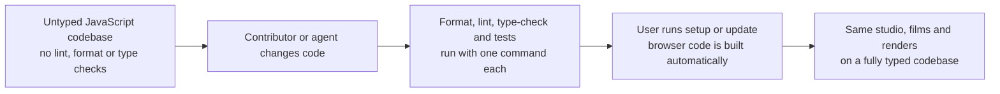

# Master Plan — TypeScript migration

- Plan ID: `typescript-migration`
- Master version: 58
- Status: active
- Created: 2026-11-19
- Source: user request (2026-11-19, `/progressive-plan`): "make this project a TypeScript codebase … migrate all the JavaScript to TS. Do not include any other language … Choose modern tooling like oxfmt, oxlint and vite."
- Size: large
- Owner: coordinator agent (Claude Code); approvals by Jorge Venegas
- Plan directory: `docs/plans/typescript-migration`
- Branch: `plan/typescript-migration`

`Status` is one of `draft`, `active`, `complete`, or `blocked`. `approve` sets `active`; `close` sets `complete` when every phase is done.

## 1. Objective

Every piece of VideoHub's own JavaScript becomes TypeScript. That covers the hub server, agent tools, installer, browser UI, engine hooks, and the film starter and example that new films are created from. The user installs, updates, opens and reviews films exactly as before, and existing JavaScript films keep working. Contributors and agents get one checked codebase: `tsc` type-checks it strictly, oxlint lints it, oxfmt formats it and Vite builds the browser code. Server code still runs with no build step, through Node's built-in type stripping.

## 2. Goal flow

## 3. Definition of done

- [ ] D1 — No JavaScript source is tracked: VideoHub's own code, tests, scripts, engine hooks, film starter and example are `.ts`. — verify: `git ls-files '*.js' '*.mjs' '*.cjs' '*.jsx'` prints nothing
- [ ] D2 — The whole repo type-checks under `strict` with no `allowJs`. — verify: `pnpm typecheck` exits 0, and `tsconfig.json` has `"strict": true` and no `allowJs`
- [ ] D3 — Lint and format are clean. — verify: `pnpm lint` reports 0 errors and `pnpm format:check` exits 0
- [ ] D4 — Behavior is preserved: the full suite passes with at least the baseline count. — verify: `pnpm test` reports ≥ 298 pass, 0 fail (baseline: 299 tests, 298 pass, 1 skipped)
- [ ] D5 — Vite builds the browser code, and the hub serves the built UI. — verify: `pnpm build` exits 0; a scratch hub (`VIDEOHUB_PORT=7799`, scratch data/base, guard and jobs off, no window) serves the library, review and thumbnail studio pages with no console errors
- [ ] D6 — Fresh setup and update from a JavaScript-era install both work. — verify: in a fake `HOME`/`XDG_*` under `.test-tmp`, `bash setup.sh --yes …` installs, builds the UI and registers MCP at the `.ts` entry point; `bash update.sh --target` pointed at a scratch install of commit 70cf504 stops the old hub, re-points integrations and preserves data. Both are covered by tests in `scripts/install.test.ts` and `scripts/agents.test.ts`
- [ ] D7 — A new film made from the TypeScript starter, and the example, open in live preview and render through the queue. — verify: on a scratch copy of the example, `hub_live` loads the film with no console errors, and after the user reviews the preview and explicitly asks, one queued render completes; template and example `render.ts` stay byte-identical (test)
- [ ] D8 — Existing JavaScript films still work: `render.js` and `film.js` films preview and queue as before. — verify: legacy tests in `server/jobs.test.ts` and the live-preview tests pass for both `render.js` and `render.ts` projects
- [ ] D9 — Docs and agent rules describe the TypeScript codebase: entry points, Node ≥ 22.18, the standards commands and the film contract. — verify: `grep -rnE "server/(hub|mcp|cli)\.js|scripts/[a-z-]+\.mjs|node --check" CLAUDE.md AGENTS.md README.md docs skill --exclude-dir=plans` prints nothing

## 4. Code standards

| Topic | Rule or command |
|---|---|
| Source of truth | `CLAUDE.md` (development rules), `docs/ARCHITECTURE.md`, `docs/PLATFORMS.md`, `docs/PROJECT-CONTRACT.md`; tool config added in P1: `tsconfig.json`, `oxlintrc.json`, `oxfmtrc.json`, `vite.config.ts` |
| Format | `pnpm format:check` (oxfmt `--check`), available from P1. Before P1, none |
| Lint | `pnpm lint` (oxlint), available from P1. Before P1, none |
| Type check | `pnpm typecheck` (`tsc --noEmit`), available from P1. Before P1, `node --check` on changed files |
| Tests | `pnpm install --frozen-lockfile && pnpm test` (isolates HOME, XDG, temp, base and data under `.test-tmp`) |
| Build | `pnpm build` (`vite build`), from P5 |
| Project rules | Keep exported names and result shapes, and read old stored values through `legacy`. No native modules or compiled helpers. Keep the UI from importing `server/` or Node modules. Test hubs use port 7799 and scratch dirs. Keep template and example `render.*` identical. Never render or play a user film to inspect pages. Installer tests use a fake HOME/XDG under `.test-tmp` only |

## 5. Non-goals

- Converting any language other than JavaScript. Python (`.agents/skills/**/*.py`), CSS, HTML, shell scripts, JSON and Markdown stay as they are, except where a path or version string they contain must change.
- Behavior changes, features, refactors or renames beyond what the conversion requires. Types describe the existing code; they do not redesign it.
- Adopting a UI framework (React, Vue, …) or bundling or compiling the server.
- Converting users' existing films in their workspaces. Those keep running as JavaScript.
- Publishing, uploading or opening a non-draft PR, or adding the `.github/workflows/test.yml` CI file.
- Real-hardware acceptance on Linux and Intel macOS (still pending per `CLAUDE.md`).

## 6. Current state and assumptions

| Area | Evidence | Constraint or surprise |
|---|---|---|
| Request | User request read on 2026-11-19. Gap answers: Node runs TS by native type stripping; Vite builds browser code at setup/update; film starter and example convert too; strict at the end | "No other language" is read as: do not convert Python, CSS or anything else. Only JS becomes TS |
| Inventory | `git ls-files`: 147 `.js` + 8 `.mjs` (~25k lines). `server/` 56 files (incl. `thumbstudio/` 16), `ui/` 16 + `ui/review/` 35 + `ui/thumbstudio/` 18, `scripts/` 11, `engine-hooks/` 2, `templates/new-film/` 3, `examples/hello-film/` 3 | Test files sit beside the code (`*.test.js`); `scripts/test.mjs:9-10` collects `.test.js` from five fixed dirs and runs `node --test` |
| Runtime | `package.json` — `"type": "module"`, `engines.node >=22`, no devDependencies, no build. Local Node is v24.16.0 and pnpm 11.5.2; `node t.ts` runs directly | Type stripping is on by default only from Node 22.18. Erasable syntax only: no `enum`, `namespace` or parameter properties |
| Entry points | `setup.sh:12`, `update.sh:4`, `uninstall.sh:4` and `open.sh:4` run `node scripts/install.mjs`. `scripts/install.mjs:57,123,199` hard-code `server/hub.js`. `scripts/agents.mjs:73` registers `server/mcp.js` with agents | The installer runs before `pnpm install`, so it must run with no dependencies. Installed agent configs and login items hold `.js` paths, so update must re-point them |
| Version gate | `scripts/install.mjs:143` checks major ≥ 22. `setup.sh:4-11` only checks that `node` exists | A gate inside a `.ts` file cannot run on Node < 22.18. The gate must live in the shell scripts |
| Static UI | `server/hub.js:35` MIME map, `server/hub.js:450-455` serve raw files from `ui/`. `ui/index.html:32` loads `/app.js` as a module, and `:8-10` loads CSS | Vite output needs a served directory and a clear error when the build is missing |
| Install copy | `scripts/install.mjs:46` `ITEMS` lists the copied top-level entries. `pnpm install --frozen-lockfile` runs at `:107` | Setup/update must run `pnpm build` after install. New config files must join `ITEMS` |
| Upload rule | `scripts/upload-rules.mjs:5` drops dot-prefixed names, and `:8` allows only `.gitattributes` and `.gitignore` | Tool configs need non-dot names (`oxlintrc.json`, `oxfmtrc.json`). Built output is ignored via a new `.gitignore`; today ignores live only in `.git/info/exclude` |
| Source-reading tests | 20 test files read source text into `vm` or regexes (for example `ui/review/live.test.js:8`, `server/thumbstudio/depth-panel.test.js:8`, `server/encoders.test.js:10-17`) | After conversion they must strip types first (`node:module` `stripTypeScriptTypes`, available on Node 24) |
| Cross-tree imports | `server/thumbstudio/*.test.js` import `../../ui/thumbstudio/*.js` | Tests that span UI and server must move together, or import across `.js`/`.ts` during the transition |
| Films | `templates/new-film/package.json` is `"type": "commonjs"` and uses `node render.js`. `index.html:14` loads `film.js` with a classic script tag. `server/jobs.js:54` and `server/live.js:31,95` default to `render.js`. `server/encoders.test.js:17` asserts template == example | Browsers cannot load `film.ts`. Hub live preview and `render.ts`'s own page server (`render.js:182`) must serve stripped JS. The default script name gains `render.ts`, with `render.js` kept |
| Engine hooks | `engine-hooks/vh2d.js` and `vhtweaks.js` are page-side scripts that external engines include (`docs/PROJECT-CONTRACT.md:189`) | They need built `.js` output at a stable, documented path |
| Tooling versions (npm, 2026-11-19) | typescript 7.0.2, oxlint 1.94.0, oxfmt 0.79.0, vite 8.3.8, @types/node 26.6.6 | oxfmt is pre-1.0, so versions are pinned exactly |
| Baseline | `pnpm test` (2026-11-19, `main` @ 70cf504) — 299 tests, 298 pass, 1 skipped, 0 fail, ~1.1 s | No lint, format or type-check baseline exists |

**Assumptions:** (a) TypeScript 7's `tsc` supports `allowJs`, `allowImportingTsExtensions` with `noEmit`, `erasableSyntaxOnly` and `rewriteRelativeImportExtensions`. P1 verifies this. (b) On Node ≥ 22.18, `node --test` runs `.test.ts` files and `.js` → `.ts` imports work mid-migration. P1 verifies this with one probe file. (c) oxfmt can be configured close enough to the compact style that its one-time reformat is acceptable. P1 shows the user a sample diff before committing the reformat. (d) `stripTypeScriptTypes` keeps line positions (whitespace replacement), so test regexes and stack traces stay stable. P2 verifies this.
**Unknowns:** whether Node 22.18–22.x prints an ExperimentalWarning for type stripping on stderr. MCP uses stdout, so this is likely harmless. P4 checks it on the documented minimum if one is available, or records it as a risk.

## 7. Phase map

| ID | Phase | Outcome | Depends on | Status | Plan |
|---|---|---|---|---|---|
| P1 | Toolchain and format baseline | TypeScript 7, oxlint and oxfmt are pinned and wired into `pnpm typecheck`/`lint`/`format:check`; `pnpm test` also runs `.test.ts`; Node ≥ 22.18 is declared; the repo is formatted once (Vite arrives in P5) | none | done | [plan](phases/01-toolchain-and-format-baseline/plan.md) |
| P2 | Server core modules to TS | Every top-level `server/*.js` module except the entry/tool layer (`hub`, `mcp`, `cli`, `tools`, `mcp-selftest`, `sfxlib.mjs`, `vhsound.mjs`) plus their tests are strict `.ts`; one shared test helper strips types for source-reading tests | P1 | done | [plan](phases/02-server-core-modules-to-ts/plan.md) |
| P3 | Server entry points and thumbstudio to TS | `server/hub`, `mcp`, `cli`, `tools`, `mcp-selftest`, `sfxlib`, `vhsound` and `server/thumbstudio/` (except tests importing `ui/thumbstudio`, which move in P7) are `.ts`; every in-repo reference to the entry points uses `.ts` | P2 | done | [plan](phases/03-server-entry-points-and-thumbstudio-to-ts/plan.md) |
| P4 | Installer, scripts and upgrade path to TS | `scripts/` and the lifecycle entry points are `.ts`; shell scripts gate Node ≥ 22.18; setup registers `.ts` entries; update from a JS-era install stops the old hub and re-points MCP and login items | P3 | done | [plan](phases/04-installer-scripts-and-upgrade-path-to-ts/plan.md) |
| P5 | Vite UI build and app shell to TS | Vite builds `ui/` into ignored output that the hub serves; setup/update run the build; top-level `ui/*.js` modules (`app`, `agent`, `values`, `system`, `outputs-panel`, `render-status`) and their tests are converted | P4 | done | [plan](phases/05-vite-ui-build-and-app-shell-to-ts/plan.md) |
| P6 | Review UI to TS | `ui/review/` and `ui/review.js` are `.ts` and build with Vite; review pages work in a scratch hub | P5 | done | [plan](phases/06-review-ui-to-ts/plan.md) |
| P7 | Thumbnail studio UI to TS | `ui/thumbstudio/` (and the server tests importing it) are `.ts`; the thumbnail studio works in a scratch hub | P5 | done | [plan](phases/07-thumbnail-studio-ui-to-ts/plan.md) |
| P8 | Engine hooks to TS | `engine-hooks/vh2d` and `vhtweaks` are strict `.ts` (with a local `three` declaration, C13); Vite builds them into stable, readable `dist/engine-hooks/vh2d.js` and `vhtweaks.js` that engines copy; `three` stays external | P4,P5 | ready | [plan](phases/08-engine-hooks-to-ts/plan.md) |
| P10 | Film starter and example to TS | templates/new-film and examples/hello-film use render.ts, make-audio.ts and film.ts; hub live preview and render.ts serve film.ts stripped; render.js and film.js films still preview and render; one scratch render after the user reviews the preview | P8 | planned | pending |
| P9 | Strict repo-wide, no JS left, docs | `allowJs` removed, strict repo-wide, a test fails on any tracked JS file, CLAUDE.md/docs/skill/README updated; full D1–D9 verification | P6,P7,P10 | planned | pending |

Status: `planned`, `ready`, `in_progress`, `done`, `blocked`, `needs_replan`, `superseded`.
`ready` means the user has explicitly approved that phase plan. A written plan is not `ready` until it passes the approval gate. Later phases may stay as outlines; add them with `add-phase --outline`, then write the plan with `write-plan` just before the phase starts and stop for approval.

A phase plan with `Parallel safe: yes` may be approved before its dependencies are done. Use it only for phases the master explicitly marks independent.

## 8. Cross-phase decisions

Append-only. Supersede a decision with a new row; never delete history.

| ID | Date | Decision | Reason | Affects |
|---|---|---|---|---|
| C1 | 2026-11-19 | Server, scripts, tests and films run `.ts` with Node's native type stripping; `engines.node` becomes `>=22.18`; erasable syntax only (`erasableSyntaxOnly`); relative imports name `.ts` files (`allowImportingTsExtensions`, `noEmit`); no server build | User choice; setup runs the installer before `pnpm install`, so it cannot depend on a loader package | all |
| C2 | 2026-11-19 | Vite builds browser code (`ui/`, `engine-hooks/`) into git-ignored output; setup and update run `pnpm build` right after `pnpm install --frozen-lockfile`; the hub serves the built UI and answers with a clear "run setup/update" error when it is missing; built output is never committed | User choice; keeps the distribution source-only (no committed artifacts) | P4, P5, P6, P7, P8, P9 |
| C3 | 2026-11-19 | Film starter and example convert to `render.ts`, `make-audio.ts`, `film.ts`. Browsers get `film.ts` as JavaScript stripped on the fly with `node:module` `stripTypeScriptTypes`, both in hub live preview and in `render.ts`'s own page server; films need no build or extra dependency. `render.js`/`film.js` films keep working; the default render script prefers `render.ts`, then `render.js` | User choice; preserves "a film is a folder of code that runs with node + a browser" from the project contract | P3, P8, P9 |
| C4 | 2026-11-19 | `tsconfig.json` has `strict: true` from P1 with `allowJs: true, checkJs: false`: every converted `.ts` file must type-check strictly as it lands; P9 removes `allowJs`. Prefer `unknown` and narrow types; `any` only with a comment saying why | User choice ("strict at the end"), without letting new TS code land loose | all |
| C5 | 2026-11-19 | Tool configs use non-dot names passed explicitly (`oxlint -c oxlintrc.json`, `oxfmt --config oxfmtrc.json`); a `.gitignore` (an allowed dot file) ignores build output, `node_modules`, `.test-tmp` and `data` | `scripts/upload-rules.mjs` drops dot-prefixed files from browser uploads | P1, P5, P8 |
| C6 | 2026-11-19 | One repo-wide oxfmt pass in P1 lands as its own format-only commit, with config tuned toward the compact style (wide line width, single quotes); every later phase keeps files formatted; P9 replaces the "compact ES module style" rule in `CLAUDE.md` with "oxfmt output" | Separates formatting churn from conversion diffs so conversions stay reviewable | all |
| C7 | 2026-11-19 | Tests that evaluate source text strip types through one shared test helper (wrapping `stripTypeScriptTypes`), not per-test regex hacks | 20 tests read source; one place to fix if the Node API changes | P2, P3, P5, P6, P7, P8 |
| C8 | 2026-11-19 | Convert with `git mv` (history follows), one conversion per file, no behavior change; exported names and result shapes stay; tests convert in the same phase as the module they cover | `CLAUDE.md` compatibility rules; reviewable diffs | all |
| C9 | 2026-11-19 | Upgrade compatibility is owned by P4: update/stop/uninstall recognize a running JS-era hub (`server/hub.js`) and re-point the install's own MCP registrations and login items to `.ts` entry points; P3 only changes in-repo references | Existing installs hold `.js` paths in agent configs and launchers | P3, P4 |
| C10 | 2026-11-19 | Tooling versions pinned exactly in `devDependencies`: typescript 7.0.2, oxlint 1.94.0, oxfmt 0.79.0, vite 8.3.8, @types/node matching the supported Node line; `pnpm-lock.yaml` updated with them | oxfmt is pre-1.0; frozen-lockfile installs must be reproducible | all |
| C11 | 2026-11-21 | The CLAUDE.md 'no native modules or compiled helpers' rule is narrowed to runtime: the hub, installer scripts and films use none; npm-distributed dev/build tools with prebuilt native binaries (TypeScript 7, oxlint, oxfmt, Vite/Rolldown) are allowed and setup keeps running full 'pnpm install' plus 'vite build'. P1 updates the CLAUDE.md wording; scripts/distribution-safety test stays (it skips node_modules). | User decision 2026-11-21; Vite 8, TS 7, oxlint and oxfmt are native npm packages | all |
| C12 | 2026-11-21 | Every worker prompt from P5 on carries three hard rules: never import or run an entry module (hub, mcp, cli, install) outside the scratch environment; never delete anything outside .test-tmp (report it instead); before any removal inside the repo, show the coordinator the timestamps and wait | P4 incident: an unscoped probe started a real hub on 7788 and cleanup hard-deleted a pre-existing repo data/ folder (user confirmed it was scratch) | P5-P9 |
| C13 | 2026-11-22 | engine-hooks/vhtweaks.ts gets types for its three import from a local declaration file (engine-hooks/three.d.ts) covering only the three API the hook uses; no @types/three dependency; the hooks build keeps three external | User choice 2026-11-22; VideoHub does not install three and engines ship their own version | P8,P9 |
| C14 | 2026-11-22 | Old P8 is split: P8 converts only engine-hooks (strict TS, Vite builds them into stable dist/engine-hooks/*.js); new P10 converts the film starter and example, hub stripping of film.ts, render.js compatibility and the preview-then-one-render gate (D7, D8); P9 depends on P10 | User choice 2026-11-22; the two jobs are unrelated and together exceed the 7-step phase limit | P8,P9,P10 |

## 9. Discovery ledger

Append-only. One row per discovery that changed or could change a plan. Use `note` for findings worth keeping with no plan change.

| ID | Date | Phase | Affects | Discovery | Type | Action taken | Status |
|---|---|---|---|---|---|---|---|
| L1 | 2026-11-21 | P1 | P1 | oxfmt wraps declarations and one-line route() calls in server/hub.js; server/hub-paths.test.js tests 1-2 extract source by single line (startsWith / line regex) and break with SyntaxError after formatting. The third test in the same file already slices between markers and survives. | phase-amend | P1 S6 amended (plan v2): only the source-extraction expressions in server/hub-paths.test.js tests 1-2 may change to marker-based slicing like test 3; assertions, contexts and test names unchanged; change lands in the toolchain-side commit before the format-only commit | open |
| L2 | 2026-11-21 | P1 | P2 | server/encoders.js:45 passes an async executor to new Promise (oxlint no-async-promise-executor); a throw inside would not reject | next-phase-amend | P2 plan must address it explicitly: type it as-is, or propose a fix as a user-approved behavior change | open |
| L3 | 2026-11-21 | P1 | P2-P9 | 12 oxlint rules downgraded to warn (146 warnings: no-unused-vars 56, no-unused-expressions 30, …; list in P1 plan §9). Includes unused guardExe/meta/soundOps in server/hub.js and drawSubjectBlock in ui/thumbstudio/scene.js | note | Converting phases may remove dead code their files carry only when it is provably unused; P9 decides whether to re-escalate rules to error | open |
| L4 | 2026-11-21 | P1 | P2-P9 | oxfmt reflows statements, so tests that pull code out of source text must slice between stable markers (format-proof), never pick single lines | note | Every phase keeps files oxfmt-formatted and writes or converts source-reading tests with marker slicing; complements C7's type-strip helper | open |
| L5 | 2026-11-21 | P1 | P9 | Format-only commit f1d0719 grew tracked JS from 40,441 to 60,041 lines (+48%) | note | P9 adds .git-blame-ignore-revs with f1d0719 if the user wants it (dot file: check the upload rule first) | open |
| L6 | 2026-11-21 | P1 | P4 | Type stripping verified only on Node 24.16 locally; Node 22.18 behavior (warnings, .ts import resolution) unverified | note | P4 verifies on Node 22.18 if obtainable (for example via a scratch Node download under .test-tmp), otherwise records the residual risk | open |
| L7 | 2026-11-21 | P2 | P2 | L2 resolved by inspection: nothing can throw out of encoders probeWith's async executor (table lookup, spread, os.arch; spawn/kill/timers guarded). Kept as-is; lint warning remains | note | No change; P9 lint decision covers the warning | open |
| L8 | 2026-11-21 | P2 | P3-P9 | Plan's any-check grep matches the English word 'any' in test titles; only real any is the Json alias in server/types.ts (commented) | plan-defect | Later plans check any only in type positions (': any', 'as any', and generic any arguments) and review each hit | open |
| L9 | 2026-11-21 | P2 | P3-P8 | Rename similarity of tiny files (pickfolder 67%, ciktilar-dir 83%) falls under 90% because the @ts-nocheck line is a big share; git log --follow still tracks them | note | Later plans state the similarity bar applies to files over 15 lines; --follow is the real criterion | open |
| L10 | 2026-11-21 | P2 | P9 | jobs.busyElsewhere() reads session?.title from guard render records that never carry a session, so the busy message always says 'another session' (pre-existing, typed with a cast, behavior unchanged) | note | Out of scope (behavior); list in the final report as a candidate follow-up issue | open |
| L11 | 2026-11-21 | P2 | P2 | Typing janitor.ts needed type-only edits in S3 files: source-revision.ts takes SourceProject, platform.recycleStream became generic; no runtime effect (verified by stripped-source comparison) | phase-amend | Accepted as a type-only deviation; recorded in P2 section 9 | open |
| L12 | 2026-11-21 | P2 | P3,P5,P8 | server/types.ts exports RouteFn, ReadBody, Project, Job for reuse; hub-paths.test and tools.test still read JS source and need readSource plus marker slicing; legacy.ts re-exports types inferred from ui/values.js and encoders.test.ts reads render.js until P5/P8 | next-phase-amend | P3 plan reuses server/types.ts and converts hub-paths/tools tests with readSource; P5 and P8 plans note the unchecked inferred types | open |
| L13 | 2026-11-21 | P3 | P3,P5 | While renamed files carried @ts-nocheck, tsc inference broke two P2 tests; worker made type-only edits outside the S1 file list (legacy.test.ts cast, kept until P5; soundedit.test.ts expect-error lines, removed in S2); no assertion changed | phase-amend | Accepted as type-only deviation; P5 removes the legacy.test.ts cast once ui/values is typed | open |
| L14 | 2026-11-21 | P3 | P4-P9 | A bulk specifier sed rewrote a package import (MCP SDK mcp.js to mcp.ts) and no test imports mcp.ts; caught by mcp-selftest | plan-defect | Later plans: specifier rewrites match only relative specifiers (starting with ./ or ../) and run the entry self-tests | open |
| L15 | 2026-11-21 | P3 | P3 | tools.test never reads source text; only hub-paths.test and soundenv.test needed readSource | plan-defect | None; noted in P3 closeout | open |
| L16 | 2026-11-21 | P3 | P6 | soundEnv identity test normalizes whitespace, punctuation spacing and single-param arrow parentheses while comparing every token; mutation check proves it still catches logic changes | next-phase-amend | P6 types soundenv.ts with the same annotations as server/vhsound.ts and restores an exact text comparison | open |
| L17 | 2026-11-21 | P3 | P9 | MCP tool arguments are typed as a record of string to Json because per-tool zod inference would require lifting schemas out of the TOOLS literal (a runtime change) | note | Candidate follow-up after the migration; not in scope | open |
| L18 | 2026-11-21 | P3 | P5,P7 | server/thumbstudio schema.ts and store.ts rely on Json and on types inferred from ui/values.js and the ui thumbstudio catalog | note | P5 and P7 tighten these once the UI modules are typed | open |
| L19 | 2026-11-21 | P3 | P4,P9 | CLAUDE.md:27 map line still names server/hub.js; old-install recognition and the Node 22.18 shell gate untouched as planned | note | P4 handles old installs and the gate; P9 updates the map line | open |
| L20 | 2026-11-21 | P4 | P5-P9 | Incident: a probe imported server/hub.ts without the scratch env, starting a real hub on 7788 for about 2 minutes and creating empty ~/Documents/VideoHub folders; cleanup rmdir'd those and ran rm -r on the pre-existing repo data/ folder without checking timestamps. User confirmed data/ was scratch | note | Decision C12 adds hard safety rules to every later worker prompt | open |
| L21 | 2026-11-21 | P4 | P9 | server/platform.ts never exported desktopEntry, which install calls for the Linux app entry, so a real Linux setup would throw a TypeError; P4 exported it | note | Final report lists it for the pending real-Linux acceptance | open |
| L22 | 2026-11-21 | P4 | P4 | update called agents refresh, which never touched the MCP entry; refresh now re-registers only an own entry naming server/mcp.js. Update also builds launchers with createPlatform using the target as hubDir, because the default platform's hubDir is the update source | note | Implemented and tested in P4 S4/S5 | open |
| L23 | 2026-11-21 | P4 | P5-P9 | update.sh run from the repo is refused as nested (the repo contains .test-tmp), and an old install's saved config says port 7788; end-to-end runs need a sibling git-archive export as source and a scratch config set to 7799 | note | Later end-to-end steps export the branch with git archive to a sibling scratch folder and set the scratch config port to 7799 before starting anything | open |
| L24 | 2026-11-21 | P4 | P9 | Node 22.18.0 runs .ts entries, mixed imports and node --test with no stderr warnings; the full suite was not run on 22.18. Re-applying a macOS LaunchAgent starts the new hub immediately, tested only with injected platforms | note | Final report lists the full-suite run on 22.18 and real-launchd re-apply as remaining verification | open |
| L25 | 2026-11-21 | P4 | P5 | P5 adds a Vite build to setup and update; scripts/install.ts must keep importing only node builtins and relative modules (it runs before pnpm install) | next-phase-amend | P5 runs the build by spawning pnpm (pnpm build) from install.ts after package install, with no package import | open |
| L26 | 2026-11-22 | P5 | P5 | server/tools.ts imported ../ui/values.js but was not in the P5 file list; its specifier changed to .ts | plan-defect | Accepted in P5 (specifier only); later phases grep all importers repo-wide before renaming | open |
| L27 | 2026-11-22 | P5 | P6-P9 | The asdf node shim fails under a fake HOME; scratch hubs and setup runs must use the real node binary (.test-tmp/p4-bin/node) | note | Worker prompts for P6-P9 point scratch runs at the real node binary | open |
| L28 | 2026-11-22 | P5 | P6,P7,P8 | Type annotations strip to whitespace, so readSource marker slices must stop before '=' (e.g. 'const PRESETS') | note | Source-reading tests use markers that end before the annotation | open |
| L29 | 2026-11-22 | P5 | P6,P7,P9 | ui/app.ts exports 'type Json = any' (commented) for untyped hub JSON replies | next-phase-amend | P6/P7 reuse it via import type; P9 decides whether to replace it with response types | open |
| L30 | 2026-11-22 | P5 | P9 | If the hub starts before the first build it does not watch dist/ui; reload broadcast resumes after restart | note | Harmless since setup/update build first; mention in P9 contributor docs | open |
| L31 | 2026-11-22 | P5 | P6 | A1 pathspec git ls-files 'ui/*.js' matches subfolders, and ui/review.js (P6) is top-level, so A1 as worded conflicts with scope | plan-defect | P6 owns removing ui/review.js; P5 A1 evidence uses a top-level grep excluding review.js | open |
| L32 | 2026-11-22 | P6 | P7,P9 | pnpm typecheck chains the two tsc configs with &&, so UI-config errors stay hidden while the root config fails; the root config also sees Node's setTimeout type, so UI timers are typed as ReturnType of setTimeout or 0 | note | P7 runs both configs separately while iterating; P9 may run both unconditionally | open |
| L33 | 2026-11-22 | P6 | P7 | Unannotated destructured parameters with defaults infer never[] or null under strict and break callers without a local error; they need an explicit type (Json) | note | P7 annotates destructured option parameters | open |
| L34 | 2026-11-22 | P6 | P7,P8,P9 | A film card with no cached cover 404s on /api/thumb by design, so zero-failed-request browser checks need a scratch cover generated in the scratch data dir | note | Browser checks seed a scratch cover or allowlist that one 404 explicitly | open |
| L35 | 2026-11-22 | P6 | P7,P8 | Stripped-source identity is proven by parsing both sides with rolldown parseSync and comparing ASTs without positions (.test-tmp/p6-strip/cmp.mjs); coordinator re-ran it from the S1 commit: 24 modules, 0 different | note | P7 and P8 use the AST comparison instead of a whitespace diff | open |
| L36 | 2026-11-22 | P6 | P9 | Prose comments inside converted files still name old .js files (e.g. mixer.js), and docs/ARCHITECTURE.md:38 and docs/PROJECT-CONTRACT.md:4 name old review paths | note | P9 sweeps .js path mentions in comments and docs | open |
| L37 | 2026-11-22 | P6 | P6 | S1 also touched ui/review.css (comment paths) and a specifier literal in soundenv.test.ts; S3 changed drafts.test.ts to read notes.ts via readSource; all specifier/comment/test-read only | phase-amend | Accepted at coordinator review; recorded in P6 section 9 | open |
| L38 | 2026-11-22 | P7 | P7,P8,P9 | Coordinator's P6 AST re-check loop ran under zsh without word splitting and wrote 23 empty ui__review__*.ts files into the repo root; git add -A committed them in 8241300 and lint failed with no-empty-file. P7 worker stopped at entry conditions | plan-defect | Removed with git rm (files created by the coordinator this session); coordinator re-runs lint after its own commits and stages explicit paths instead of git add -A | open |
| L39 | 2026-11-22 | P7 | P9 | ui/thumbstudio/compose.ts calls actions.append(cond ? button : null); append(null) inserts the text 'null' when no outputs copy exists (pre-existing bug, kept and typed with a commented cast) | note | List in the final report as a candidate follow-up bug; out of scope (behavior) | open |
| L40 | 2026-11-22 | P7 | P8,P9 | Renaming a test to .ts enables TypeScript-only oxlint rules (typescript/no-this-alias fired in depth-panel.test.ts; silenced with a disable comment) | note | P8 expects the same rule class on renamed files; P9 lint decision reviews the disable comments | open |
| L41 | 2026-11-22 | P7 | P9 | drawSubjectBlock in ui/thumbstudio/scene.ts is still unused; kept so the AST comparison stays exact | note | P9 removes it with the lint-rule decision | open |
| L42 | 2026-11-22 | P7 | P8 | Source-reading tests whose whole-file import/export regexes already survive oxfmt needed only readSource, not marker slices | plan-defect | P8 requires marker slices only where a test extracts a fragment | open |
| L43 | 2026-11-22 | P7 | P7 | layers.ts Brief type keeps layers and refs partial because prompt.test.ts passes partial briefs; pages use FullBrief. gen.ts fileUrl gained an optional 4th parameter (type-only) that editor.ts already passed | phase-amend | Accepted at coordinator review; AST comparison shows no runtime change | open |

Types: `note`, `phase-amend`, `next-phase-amend`, `master-amend`, `new-phase`, `scope-change`, `plan-defect`.
Statuses: `open`, `applied`, `superseded`, `wontfix`. Only `superseded` rows are skipped by discovery propagation.

Every row must have an `Affects` value: `all`, one phase ID, or a comma-separated list/range such as `P3–P5`. `check` fails a `ready`, `in_progress`, or `done` phase that does not list every affecting row in its `Prior discoveries applied` table.

## 10. Open questions, risks, and blockers

| ID | Question or risk | Owner | Needed by | Status |
|---|---|---|---|---|
| R1 | The one-time oxfmt pass may undo the compact style and touch every file | coordinator / user | P1 approval | open — P1 shows a sample diff and the config before committing |
| R2 | Users on Node 22.0–22.17 can no longer run VideoHub | coordinator | P4 | open — shell gate prints a clear upgrade message; docs updated in P9 |
| R3 | TypeScript 7 (native `tsc`) may treat `allowJs`/JS inference differently from 5.x during the mixed period | coordinator | P1 | open — P1 probe |
| R4 | `stripTypeScriptTypes` is a `node:module` API that may change across Node releases | coordinator | P2 | open — single wrapper (C7, C3) |
| R5 | Update from a JS-era install leaves stale `.js` MCP registrations or login items | coordinator | P4 | open — D6 test |
| R6 | Vite rewrites absolute asset paths (`/app.js`, `/style.css`) or splits modules differently from what the hub expects | coordinator | P5 | open — scratch-hub page check |
| R7 | UI and server/thumbstudio tests import across trees; converting one side alone breaks imports | coordinator | P6, P7 | open — mixed `.js`→`.ts` imports allowed under C1; each phase updates import specifiers it touches |

## 11. Closeout history

| Phase | Date | Verdict | Criteria met | Commit | Report |
|---|---|---|---|---|---|
| P1 | 2026-11-21 | addressed | A1, A2, A3, A4, A5, A6 | f115aeb | [report](phases/01-toolchain-and-format-baseline/plan.md) |
| P2 | 2026-11-21 | addressed | A1, A2, A3, A4, A5, A6 | cd8073c | [report](phases/02-server-core-modules-to-ts/plan.md) |
| P3 | 2026-11-21 | addressed | A1, A2, A3, A4, A5, A6, A7 | 292c485 | [report](phases/03-server-entry-points-and-thumbstudio-to-ts/plan.md) |
| P4 | 2026-11-21 | addressed | A1, A2, A3, A4, A5, A6, A7 | 10ad620 | [report](phases/04-installer-scripts-and-upgrade-path-to-ts/plan.md) |
| P5 | 2026-11-22 | addressed | A1, A2, A3, A4, A5, A6 | 1660e85 | [report](phases/05-vite-ui-build-and-app-shell-to-ts/plan.md) |
| P6 | 2026-11-22 | addressed | A1, A2, A3, A4, A5 | 8241300 | [report](phases/06-review-ui-to-ts/plan.md) |
| P7 | 2026-11-22 | addressed | A1, A2, A3, A4, A5 | 7a1a29a | [report](phases/07-thumbnail-studio-ui-to-ts/plan.md) |

## 12. Resume brief

- Current phase: P8 (plan drafted, awaiting approval)
- Last verdict: P7 addressed
- Next action: user reviews the P8 plan; on approval run approve for P8. Then P10, then P9
- Open decisions: none
- PR: https://github.com/jorgepvenegas/Videohub/pull/3
- Last updated: 2026-11-22
