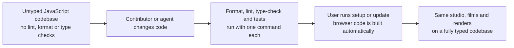

# Master Plan — TypeScript migration

- Plan ID: `typescript-migration`
- Master version: 11
- Status: active
- Created: 2026-11-19
- Source: user request (2026-11-19, `/progressive-plan`): "make this project a TypeScript codebase … migrate all the JavaScript to TS. Do not include any other language … Choose modern tooling like oxfmt, oxlint and vite."
- Size: large
- Owner: coordinator agent (Claude Code); approvals by Jorge Venegas
- Plan directory: `docs/plans/typescript-migration`
- Branch: `plan/typescript-migration`

`Status` is one of `draft`, `active`, `complete`, or `blocked`. `approve` sets `active`; `close` sets `complete` when every phase is done.

## 1. Objective

Every piece of VideoHub's own JavaScript becomes TypeScript. That covers the hub server, agent tools, installer, browser UI, engine hooks, and the film starter and example that new films are created from. The user installs, updates, opens and reviews films exactly as before, and existing JavaScript films keep working. Contributors and agents get one checked codebase: `tsc` type-checks it strictly, oxlint lints it, oxfmt formats it and Vite builds the browser code. Server code still runs with no build step, through Node's built-in type stripping.

## 2. Goal flow

## 3. Definition of done

- [ ] D1 — No JavaScript source is tracked: VideoHub's own code, tests, scripts, engine hooks, film starter and example are `.ts`. — verify: `git ls-files '*.js' '*.mjs' '*.cjs' '*.jsx'` prints nothing
- [ ] D2 — The whole repo type-checks under `strict` with no `allowJs`. — verify: `pnpm typecheck` exits 0, and `tsconfig.json` has `"strict": true` and no `allowJs`
- [ ] D3 — Lint and format are clean. — verify: `pnpm lint` reports 0 errors and `pnpm format:check` exits 0
- [ ] D4 — Behavior is preserved: the full suite passes with at least the baseline count. — verify: `pnpm test` reports ≥ 298 pass, 0 fail (baseline: 299 tests, 298 pass, 1 skipped)
- [ ] D5 — Vite builds the browser code, and the hub serves the built UI. — verify: `pnpm build` exits 0; a scratch hub (`VIDEOHUB_PORT=7799`, scratch data/base, guard and jobs off, no window) serves the library, review and thumbnail studio pages with no console errors
- [ ] D6 — Fresh setup and update from a JavaScript-era install both work. — verify: in a fake `HOME`/`XDG_*` under `.test-tmp`, `bash setup.sh --yes …` installs, builds the UI and registers MCP at the `.ts` entry point; `bash update.sh --target` pointed at a scratch install of commit 70cf504 stops the old hub, re-points integrations and preserves data. Both are covered by tests in `scripts/install.test.ts` and `scripts/agents.test.ts`
- [ ] D7 — A new film made from the TypeScript starter, and the example, open in live preview and render through the queue. — verify: on a scratch copy of the example, `hub_live` loads the film with no console errors, and after the user reviews the preview and explicitly asks, one queued render completes; template and example `render.ts` stay byte-identical (test)
- [ ] D8 — Existing JavaScript films still work: `render.js` and `film.js` films preview and queue as before. — verify: legacy tests in `server/jobs.test.ts` and the live-preview tests pass for both `render.js` and `render.ts` projects
- [ ] D9 — Docs and agent rules describe the TypeScript codebase: entry points, Node ≥ 22.18, the standards commands and the film contract. — verify: `grep -rnE "server/(hub|mcp|cli)\.js|scripts/[a-z-]+\.mjs|node --check" CLAUDE.md AGENTS.md README.md docs skill --exclude-dir=plans` prints nothing

## 4. Code standards

| Topic | Rule or command |
|---|---|
| Source of truth | `CLAUDE.md` (development rules), `docs/ARCHITECTURE.md`, `docs/PLATFORMS.md`, `docs/PROJECT-CONTRACT.md`; tool config added in P1: `tsconfig.json`, `oxlintrc.json`, `oxfmtrc.json`, `vite.config.ts` |
| Format | `pnpm format:check` (oxfmt `--check`), available from P1. Before P1, none |
| Lint | `pnpm lint` (oxlint), available from P1. Before P1, none |
| Type check | `pnpm typecheck` (`tsc --noEmit`), available from P1. Before P1, `node --check` on changed files |
| Tests | `pnpm install --frozen-lockfile && pnpm test` (isolates HOME, XDG, temp, base and data under `.test-tmp`) |
| Build | `pnpm build` (`vite build`), from P5 |
| Project rules | Keep exported names and result shapes, and read old stored values through `legacy`. No native modules or compiled helpers. Keep the UI from importing `server/` or Node modules. Test hubs use port 7799 and scratch dirs. Keep template and example `render.*` identical. Never render or play a user film to inspect pages. Installer tests use a fake HOME/XDG under `.test-tmp` only |

## 5. Non-goals

- Converting any language other than JavaScript. Python (`.agents/skills/**/*.py`), CSS, HTML, shell scripts, JSON and Markdown stay as they are, except where a path or version string they contain must change.
- Behavior changes, features, refactors or renames beyond what the conversion requires. Types describe the existing code; they do not redesign it.
- Adopting a UI framework (React, Vue, …) or bundling or compiling the server.
- Converting users' existing films in their workspaces. Those keep running as JavaScript.
- Publishing, uploading or opening a non-draft PR, or adding the `.github/workflows/test.yml` CI file.
- Real-hardware acceptance on Linux and Intel macOS (still pending per `CLAUDE.md`).

## 6. Current state and assumptions

| Area | Evidence | Constraint or surprise |
|---|---|---|
| Request | User request read on 2026-11-19. Gap answers: Node runs TS by native type stripping; Vite builds browser code at setup/update; film starter and example convert too; strict at the end | "No other language" is read as: do not convert Python, CSS or anything else. Only JS becomes TS |
| Inventory | `git ls-files`: 147 `.js` + 8 `.mjs` (~25k lines). `server/` 56 files (incl. `thumbstudio/` 16), `ui/` 16 + `ui/review/` 35 + `ui/thumbstudio/` 18, `scripts/` 11, `engine-hooks/` 2, `templates/new-film/` 3, `examples/hello-film/` 3 | Test files sit beside the code (`*.test.js`); `scripts/test.mjs:9-10` collects `.test.js` from five fixed dirs and runs `node --test` |
| Runtime | `package.json` — `"type": "module"`, `engines.node >=22`, no devDependencies, no build. Local Node is v24.16.0 and pnpm 11.5.2; `node t.ts` runs directly | Type stripping is on by default only from Node 22.18. Erasable syntax only: no `enum`, `namespace` or parameter properties |
| Entry points | `setup.sh:12`, `update.sh:4`, `uninstall.sh:4` and `open.sh:4` run `node scripts/install.mjs`. `scripts/install.mjs:57,123,199` hard-code `server/hub.js`. `scripts/agents.mjs:73` registers `server/mcp.js` with agents | The installer runs before `pnpm install`, so it must run with no dependencies. Installed agent configs and login items hold `.js` paths, so update must re-point them |
| Version gate | `scripts/install.mjs:143` checks major ≥ 22. `setup.sh:4-11` only checks that `node` exists | A gate inside a `.ts` file cannot run on Node < 22.18. The gate must live in the shell scripts |
| Static UI | `server/hub.js:35` MIME map, `server/hub.js:450-455` serve raw files from `ui/`. `ui/index.html:32` loads `/app.js` as a module, and `:8-10` loads CSS | Vite output needs a served directory and a clear error when the build is missing |
| Install copy | `scripts/install.mjs:46` `ITEMS` lists the copied top-level entries. `pnpm install --frozen-lockfile` runs at `:107` | Setup/update must run `pnpm build` after install. New config files must join `ITEMS` |
| Upload rule | `scripts/upload-rules.mjs:5` drops dot-prefixed names, and `:8` allows only `.gitattributes` and `.gitignore` | Tool configs need non-dot names (`oxlintrc.json`, `oxfmtrc.json`). Built output is ignored via a new `.gitignore`; today ignores live only in `.git/info/exclude` |
| Source-reading tests | 20 test files read source text into `vm` or regexes (for example `ui/review/live.test.js:8`, `server/thumbstudio/depth-panel.test.js:8`, `server/encoders.test.js:10-17`) | After conversion they must strip types first (`node:module` `stripTypeScriptTypes`, available on Node 24) |
| Cross-tree imports | `server/thumbstudio/*.test.js` import `../../ui/thumbstudio/*.js` | Tests that span UI and server must move together, or import across `.js`/`.ts` during the transition |
| Films | `templates/new-film/package.json` is `"type": "commonjs"` and uses `node render.js`. `index.html:14` loads `film.js` with a classic script tag. `server/jobs.js:54` and `server/live.js:31,95` default to `render.js`. `server/encoders.test.js:17` asserts template == example | Browsers cannot load `film.ts`. Hub live preview and `render.ts`'s own page server (`render.js:182`) must serve stripped JS. The default script name gains `render.ts`, with `render.js` kept |
| Engine hooks | `engine-hooks/vh2d.js` and `vhtweaks.js` are page-side scripts that external engines include (`docs/PROJECT-CONTRACT.md:189`) | They need built `.js` output at a stable, documented path |
| Tooling versions (npm, 2026-11-19) | typescript 7.0.2, oxlint 1.94.0, oxfmt 0.79.0, vite 8.3.8, @types/node 26.6.6 | oxfmt is pre-1.0, so versions are pinned exactly |
| Baseline | `pnpm test` (2026-11-19, `main` @ 70cf504) — 299 tests, 298 pass, 1 skipped, 0 fail, ~1.1 s | No lint, format or type-check baseline exists |

**Assumptions:** (a) TypeScript 7's `tsc` supports `allowJs`, `allowImportingTsExtensions` with `noEmit`, `erasableSyntaxOnly` and `rewriteRelativeImportExtensions`. P1 verifies this. (b) On Node ≥ 22.18, `node --test` runs `.test.ts` files and `.js` → `.ts` imports work mid-migration. P1 verifies this with one probe file. (c) oxfmt can be configured close enough to the compact style that its one-time reformat is acceptable. P1 shows the user a sample diff before committing the reformat. (d) `stripTypeScriptTypes` keeps line positions (whitespace replacement), so test regexes and stack traces stay stable. P2 verifies this.
**Unknowns:** whether Node 22.18–22.x prints an ExperimentalWarning for type stripping on stderr. MCP uses stdout, so this is likely harmless. P4 checks it on the documented minimum if one is available, or records it as a risk.

## 7. Phase map

| ID | Phase | Outcome | Depends on | Status | Plan |
|---|---|---|---|---|---|
| P1 | Toolchain and format baseline | TypeScript 7, oxlint and oxfmt are pinned and wired into `pnpm typecheck`/`lint`/`format:check`; `pnpm test` also runs `.test.ts`; Node ≥ 22.18 is declared; the repo is formatted once (Vite arrives in P5) | none | ready | [plan](phases/01-toolchain-and-format-baseline/plan.md) |
| P2 | Server core modules to TS | Every top-level `server/*.js` module except the entry/tool layer (`hub`, `mcp`, `cli`, `tools`, `mcp-selftest`, `sfxlib.mjs`, `vhsound.mjs`) plus their tests are strict `.ts`; one shared test helper strips types for source-reading tests | P1 | planned | pending |
| P3 | Server entry points and thumbstudio to TS | `server/hub`, `mcp`, `cli`, `tools`, `mcp-selftest`, `sfxlib`, `vhsound` and `server/thumbstudio/` (except tests importing `ui/thumbstudio`, which move in P7) are `.ts`; every in-repo reference to the entry points uses `.ts` | P2 | planned | pending |
| P4 | Installer, scripts and upgrade path to TS | `scripts/` and the lifecycle entry points are `.ts`; shell scripts gate Node ≥ 22.18; setup registers `.ts` entries; update from a JS-era install stops the old hub and re-points MCP and login items | P3 | planned | pending |
| P5 | Vite UI build and app shell to TS | Vite builds `ui/` into ignored output that the hub serves; setup/update run the build; top-level `ui/*.js` modules (`app`, `agent`, `values`, `system`, `outputs-panel`, `render-status`) and their tests are converted | P4 | planned | pending |
| P6 | Review UI to TS | `ui/review/` and `ui/review.js` are `.ts` and build with Vite; review pages work in a scratch hub | P5 | planned | pending |
| P7 | Thumbnail studio UI to TS | `ui/thumbstudio/` (and the server tests importing it) are `.ts`; the thumbnail studio works in a scratch hub | P5 | planned | pending |
| P8 | Engine hooks and film starter to TS | `engine-hooks/` build to stable `.js` paths; the film starter and example are `render.ts`/`make-audio.ts`/`film.ts`; hub live preview and `render.ts` serve stripped `film.ts`; `render.js` films still work | P4,P5 | planned | pending |
| P9 | Strict repo-wide, no JS left, docs | `allowJs` removed, strict repo-wide, a test fails on any tracked JS file, CLAUDE.md/docs/skill/README updated; full D1–D9 verification | P6,P7,P8 | planned | pending |

Status: `planned`, `ready`, `in_progress`, `done`, `blocked`, `needs_replan`, `superseded`.
`ready` means the user has explicitly approved that phase plan. A written plan is not `ready` until it passes the approval gate. Later phases may stay as outlines; add them with `add-phase --outline`, then write the plan with `write-plan` just before the phase starts and stop for approval.

A phase plan with `Parallel safe: yes` may be approved before its dependencies are done. Use it only for phases the master explicitly marks independent.

## 8. Cross-phase decisions

Append-only. Supersede a decision with a new row; never delete history.

| ID | Date | Decision | Reason | Affects |
|---|---|---|---|---|
| C1 | 2026-11-19 | Server, scripts, tests and films run `.ts` with Node's native type stripping; `engines.node` becomes `>=22.18`; erasable syntax only (`erasableSyntaxOnly`); relative imports name `.ts` files (`allowImportingTsExtensions`, `noEmit`); no server build | User choice; setup runs the installer before `pnpm install`, so it cannot depend on a loader package | all |
| C2 | 2026-11-19 | Vite builds browser code (`ui/`, `engine-hooks/`) into git-ignored output; setup and update run `pnpm build` right after `pnpm install --frozen-lockfile`; the hub serves the built UI and answers with a clear "run setup/update" error when it is missing; built output is never committed | User choice; keeps the distribution source-only (no committed artifacts) | P4, P5, P6, P7, P8, P9 |
| C3 | 2026-11-19 | Film starter and example convert to `render.ts`, `make-audio.ts`, `film.ts`. Browsers get `film.ts` as JavaScript stripped on the fly with `node:module` `stripTypeScriptTypes`, both in hub live preview and in `render.ts`'s own page server; films need no build or extra dependency. `render.js`/`film.js` films keep working; the default render script prefers `render.ts`, then `render.js` | User choice; preserves "a film is a folder of code that runs with node + a browser" from the project contract | P3, P8, P9 |
| C4 | 2026-11-19 | `tsconfig.json` has `strict: true` from P1 with `allowJs: true, checkJs: false`: every converted `.ts` file must type-check strictly as it lands; P9 removes `allowJs`. Prefer `unknown` and narrow types; `any` only with a comment saying why | User choice ("strict at the end"), without letting new TS code land loose | all |
| C5 | 2026-11-19 | Tool configs use non-dot names passed explicitly (`oxlint -c oxlintrc.json`, `oxfmt --config oxfmtrc.json`); a `.gitignore` (an allowed dot file) ignores build output, `node_modules`, `.test-tmp` and `data` | `scripts/upload-rules.mjs` drops dot-prefixed files from browser uploads | P1, P5, P8 |
| C6 | 2026-11-19 | One repo-wide oxfmt pass in P1 lands as its own format-only commit, with config tuned toward the compact style (wide line width, single quotes); every later phase keeps files formatted; P9 replaces the "compact ES module style" rule in `CLAUDE.md` with "oxfmt output" | Separates formatting churn from conversion diffs so conversions stay reviewable | all |
| C7 | 2026-11-19 | Tests that evaluate source text strip types through one shared test helper (wrapping `stripTypeScriptTypes`), not per-test regex hacks | 20 tests read source; one place to fix if the Node API changes | P2, P3, P5, P6, P7, P8 |
| C8 | 2026-11-19 | Convert with `git mv` (history follows), one conversion per file, no behavior change; exported names and result shapes stay; tests convert in the same phase as the module they cover | `CLAUDE.md` compatibility rules; reviewable diffs | all |
| C9 | 2026-11-19 | Upgrade compatibility is owned by P4: update/stop/uninstall recognize a running JS-era hub (`server/hub.js`) and re-point the install's own MCP registrations and login items to `.ts` entry points; P3 only changes in-repo references | Existing installs hold `.js` paths in agent configs and launchers | P3, P4 |
| C10 | 2026-11-19 | Tooling versions pinned exactly in `devDependencies`: typescript 7.0.2, oxlint 1.94.0, oxfmt 0.79.0, vite 8.3.8, @types/node matching the supported Node line; `pnpm-lock.yaml` updated with them | oxfmt is pre-1.0; frozen-lockfile installs must be reproducible | all |
| C11 | 2026-11-21 | The CLAUDE.md 'no native modules or compiled helpers' rule is narrowed to runtime: the hub, installer scripts and films use none; npm-distributed dev/build tools with prebuilt native binaries (TypeScript 7, oxlint, oxfmt, Vite/Rolldown) are allowed and setup keeps running full 'pnpm install' plus 'vite build'. P1 updates the CLAUDE.md wording; scripts/distribution-safety test stays (it skips node_modules). | User decision 2026-11-21; Vite 8, TS 7, oxlint and oxfmt are native npm packages | all |

## 9. Discovery ledger

Append-only. One row per discovery that changed or could change a plan. Use `note` for findings worth keeping with no plan change.

| ID | Date | Phase | Affects | Discovery | Type | Action taken | Status |
|---|---|---|---|---|---|---|---|

Types: `note`, `phase-amend`, `next-phase-amend`, `master-amend`, `new-phase`, `scope-change`, `plan-defect`.
Statuses: `open`, `applied`, `superseded`, `wontfix`. Only `superseded` rows are skipped by discovery propagation.

Every row must have an `Affects` value: `all`, one phase ID, or a comma-separated list/range such as `P3–P5`. `check` fails a `ready`, `in_progress`, or `done` phase that does not list every affecting row in its `Prior discoveries applied` table.

## 10. Open questions, risks, and blockers

| ID | Question or risk | Owner | Needed by | Status |
|---|---|---|---|---|
| R1 | The one-time oxfmt pass may undo the compact style and touch every file | coordinator / user | P1 approval | open — P1 shows a sample diff and the config before committing |
| R2 | Users on Node 22.0–22.17 can no longer run VideoHub | coordinator | P4 | open — shell gate prints a clear upgrade message; docs updated in P9 |
| R3 | TypeScript 7 (native `tsc`) may treat `allowJs`/JS inference differently from 5.x during the mixed period | coordinator | P1 | open — P1 probe |
| R4 | `stripTypeScriptTypes` is a `node:module` API that may change across Node releases | coordinator | P2 | open — single wrapper (C7, C3) |
| R5 | Update from a JS-era install leaves stale `.js` MCP registrations or login items | coordinator | P4 | open — D6 test |
| R6 | Vite rewrites absolute asset paths (`/app.js`, `/style.css`) or splits modules differently from what the hub expects | coordinator | P5 | open — scratch-hub page check |
| R7 | UI and server/thumbstudio tests import across trees; converting one side alone breaks imports | coordinator | P6, P7 | open — mixed `.js`→`.ts` imports allowed under C1; each phase updates import specifiers it touches |

## 11. Closeout history

| Phase | Date | Verdict | Criteria met | Commit | Report |
|---|---|---|---|---|---|

## 12. Resume brief

- Current phase: P1 (plan drafted, awaiting approval)
- Last verdict: none
- Next action: user reviews master and P1 plan; on approval run `approve docs/plans/typescript-migration P1`
- Open decisions: none
- PR: https://github.com/jorgepvenegas/Videohub/pull/3
- Last updated: 2026-11-21
